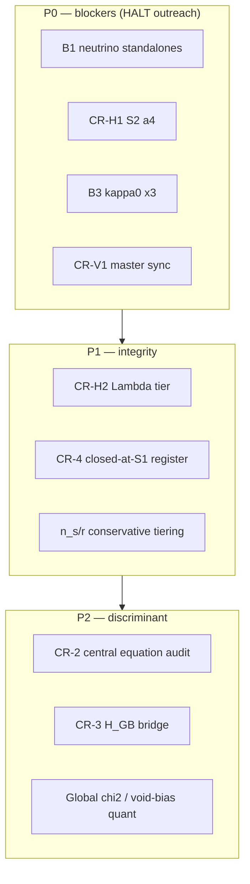

# CR2 Sunshine / Rabbit Hole Programme — systematic weakness remediation

**Authority:** Greg 2026-06-01 — full autonomous authorisation; coordinate AC+Jammer + PC+Scratch auto streams  
**Trigger:** Convergent CR + Cursor critical reviews (Lesson #28 recognition gate)  
**Status:** **CLOSED** (AC full MB stamp 2026-06-13) — wave 2 patch lane complete; J-Φ-7 / Susskind / Book tracked outside CR2  
**Extension scorecard:** `Working/NTE_Extension_Scorecard_20260601.md` — Greg discipline: **zero incorrect claims > any claim**  
**Supersedes:** P0 Sunshine Audit (closed 2026-05-25) as *methodology template*; this is **CR2** (post-dual-review)  
**Lane note (2026-06-01):** Greg reroute — Claude lanes quiet; **all open CR2 work on Cursor autonomous streams** (`Handoff_Cursor_to_Greg_Claude_Reroute_All_Cursor_Auto_20260601.md`)

**Queue priority (2026-06-02):** Sunshine/Rabbit Hole items are **first** in don't-go-idle (`NTE_CR2_Open_Work_Registry.json` `queue_policy`; wave 11). Ontological bridge (`lane=bridge`) runs only when no sunshine priority 0–1 pending.

---

## §0 — Recognition gate (Lesson #28)

CR and Cursor independently produced full-corpus reviews in the same session. **Convergence = high-confidence weaknesses.** **Divergence = complementary coverage.** Combined blocking set for external submission:

| ID | Issue | Owner lane | Status |
|----|--------|------------|--------|
| **B1** | Neutrino atmospheric comparand + mass-ratio falsification (P5/C13/S6) | **Cursor** (Claude reroute 2026-06-01) | ✅ **Tier 1 + verify PASS** — P5 v0.2, C13 §4.4, S6 tech+pivot, Popular, Campaign (MAIN-01, PS-03/04, PS-06); **residual:** P5 pedagogical pivot, C7 §7.3, C10 table |
| **B3** | κ₀ ×3 spinor vs Killing-vector conflation | **Cursor Main + PC** | ✅ **PATCHED** — Hopf technical + Kappa AB (MAIN-06); C7 §4 (AJ-03); Hopf PC pivot (PS-05); κ₀ = 3/√(4π) unchanged |
| **CR-H1** | S2 §5.5 a₄ contradicts §5.4 | **Cursor Main** | ✅ **RESOLVED** — a₄=0 (AC+Scratch audited); **S2 patched** (MAIN-05) |
| **CR-H2** | C11 Λ tier / 2π² vs 4π ambiguity | **Cursor AC** (AJ-03) | ✅ **CLOSED** — structural Λ stands; 1.05× reroute-or-retire; **C12/Part3 patched** (AJ-03) |
| **CR-V1** | Master trilogy version skew (P3 v10.17.7 vs P1–2 v10.17.1) | **Cursor Main** | 🔄 **PARTIAL** — headers + uncontroversial body sync (MAIN-08); contested prose merge **AC-gated** |

**Secondary queue:** CR-2 (central equation tautology doc), CR-3 (H_GB scale bridge), CR-4 (closed-at-S1 register convention), n_s/r conservative tiering (AC).

---

## §1 — Programme structure (P0 Sunshine template)

**Handoff chain (same as P0 Sunshine):** Cursor render → Scratch adversarial → Jammer numerics → AC ratify → Greg external gate.

---

## §2 — Work packages

### WP-B1 — Neutrino ratio (P0)

**Root cause (CR):** m_ν₃/m_ν₂ predicted = (8π)^(2/3) ≈ 8.57 vs observed √(Δm²₃₁/Δm²₂₁) ≈ 5.82 → single M_R **cannot** fit both. Master §19.2 honest ("factor ~1.5"); standalones wrongly claim 0.997× atmospheric.

**Status (2026-06-01, wave 2):** Patch lanes **Cursor-owned** (Claude reroute). **Shipped:** P5 v0.2 §5–§6 + abstract + falsifier #5; C13 v0.17.2 §4.4 + tier register + §8 falsifier #5; S6 tech + PC pivot v1.0 (PS-03); Distribution Campaign §6.8 Raffelt row + Popular v10.8 B1 scrub (MAIN-01, PS-04); **PS-06 adversarial verify PASS** (`Working/CR2_B1_Cursor_Scratch_Verify_Memo_20260601.md`). **Residual (non–Tier-1 blockers):** P5 pedagogical pivot still claims 0.997× simultaneous fit; C7 §7.3 + C10 table stale; MAIN-09 cosmetic (C13 §1/§7).

**Cursor actions (done unless noted):**
- ✅ Patch P5 v0.2 §5–§6, abstract, falsifier #5
- ✅ Patch C13 v0.17.2 §4.4, tier register, §8 falsifier #5
- ✅ S6 pivot v1.0 § atmospheric cross-check (PS-03)
- ✅ Grep Distribution Campaign + Popular for "simultaneous" / "0.997×" (MAIN-01, PS-04)
- ✅ PS-06 adversarial verify — **PASS**
- 🔄 P5 pedagogical pivot B1 scrub (queued PC or Main)
- 🔄 C7 §7.3 / C10 B1 residual (queued AC or Main)

**Jammer:** Seesaw denominator / M_R convention check — verdict in AJ-02 bundle  
**AC:** Tier downgrade C13 "clean Tier A" → **solar-only Tier A with atmospheric caveat** — ratification bundle AJ-02 filed

**Candidate forward pathway (2026-06-01, Scratch — NOT CLOSED):**  
`Working/CR2_B1_Killing2_vs_Adjoint3_Neutrino_Pathway_Scratch_Claude_20260601.md` — σ₃ neutrino as chirality-superposed **Killing-spinor mode (dim 2)** vs naive **adjoint su(2) count (dim 3)** re-normalisation → m_ν₃ × (2/3) → ratio (2/3)(8π)^(2/3) ≈ 5.72; solar leg untouched; κ₀ = 3/√(4π) preserved; disambiguates B3 by separation not rescale. **Status: CANDIDATE — NOT CLOSED.**

**Killing2 derivation (AJ-10, Cursor Jammer):** ✅ **NEEDS-MORE** — `Working/CR2_B1_Killing2_Derivation_Memo_Cursor_Jammer_20260601.md`. Numerical landing ~2% both legs; structural hook plausible; load-bearing steps **not closed** — corpus does **not** adjoint-overcount $m_{\nu_3}$ ($Y_3=1$ convention refutes premise F5); chirality amplitude → ×1; σ₁/σ₂ escape unstipulated; B3 already disambiguates 2 vs 3 without neutrino 2/3. **No corpus 2/3 patch.**

**Killing2 adversarial (PS-12, Cursor Scratch):** ✅ **ADVERSARIAL-PENDING-DERIVATION** — `Working/CR2_B1_Killing2_Adversarial_Cursor_Scratch_20260601.md`. Not numerology-only (CONDITIONAL-STRUCTURE); falsifiers (a)–(c) open; **no PASS on closure** pending Programme S derivation.

**Programme S derivation queue (2026-06-01, MAIN-15):**  
Downstream of AJ-10 **NEEDS-MORE** — explicit $D_F$ closure attempt per Jammer memo §5 (Paper S6 lane). **Corpus honest-scope language unchanged** — solar sub-1%, atmospheric structural ≈1.5× — until Programme S **PASS** + AC ratify; **no 2/3 patch** to Tier 1 standalones without closed chain.

| Queue ID | Stream | Scope | Target artifact | Gate |
|----------|--------|-------|-----------------|------|
| **AJ-11** | Cursor Jammer | Explicit σ₃ mass matrix element on $D_F$; compute $Y_3$ from Killing-spinor/Cartan projection; unified σᵢ treatment; chirality map C7a; falsify dim-ratio alternatives (F1–F6) | `Working/CR2_Programme_S_Sigma3_Y3_Derivation_Memo_Cursor_Jammer_20260601.md` | ✅ **NEEDS-MORE** — $Y_3=1$ not $\sqrt{2/3}$; F1 triggered; **no corpus patch** |
| **PS-13** | Cursor Scratch | Adversarial verify AJ-11 memo; falsifiers F1–F6 from Jammer memo | `Working/CR2_Programme_S_Sigma3_Adversarial_Cursor_Scratch_20260601.md` | ✅ **PENDING** — AJ-11 confirmed; not PASS on closure; **no corpus patch** |

**AJ-11 deliverables (from AJ-10 §5):**
1. Explicit σ₃ mass matrix element on $D_F$ — target $Y_3 = \sqrt{2/3}$ if pathway holds
2. Unified σᵢ treatment — $(8\pi)^{-2/3}$ transverse + $(2/3)$ Cartan **without tuning**
3. Chirality map — which fixed-sign Killing spinor carries $\nu_3$ mass (C7a)
4. Falsify numerology — 2/3 unique among dim-ratio candidates from same operator

**Cross-refs:** Scratch pathway memo; AJ-10 derivation memo §5–§7; PS-12 adversarial; `Handoff_Cursor_Main_to_AC_B1_Killing2_Pathway_Verdict_20260601.md`

### WP-CR-H1 — S2 a₄ Gilkey recompute (P0)

**Claim under test:** On M = S³×S¹, §5.4 gives C²=E₄=0 ⇒ F₁=0 identically. Standard Dirac a₄ ∝ ∫F₁ ⇒ **a₄ should vanish** unless Lichnerowicz E=R/4 adds separate terms §5.1 omits from F₁.

**Status:** ✅ **RESOLVED** — a₄=0 (AC disposition + Scratch audit, PS-01 FAIL on a₄≠0 route). **S2 corpus patched** (MAIN-05): §5.4–§5.5 coherent; Route B/E terms documented in memo; Λ closure reroutes per CR-H2.

**Artifacts:**
- `Working/CR2_S2_a4_Gilkey_Recompute_Memo_Cursor_20260601.md`
- `Working/cr2_s2_a4_gilkey_check.py` — numeric/symbolic on R=6 product

**Outcome applied:** (A) a₄=0 → Λ closure rerouted (CR-H2 closed); no a₄≠0 rewrite required.

### WP-B3 — κ₀ ×3 (P0)

**Gap:** Fixed-sign Killing spinors 2-dim vs dim su(2)=3 **vector fields** conflated as 3 spinor channels.

**Status (2026-06-01, wave 2):** Patch lanes **Cursor-owned** (Claude reroute). **Shipped:** Hopf bare-coupling + Kappa AB rep-theory language (MAIN-06); C7 §4 gauge-component clarification (AJ-03); Hopf PC pivot v1.0 B3 mirror (PS-05). κ₀ = 3/√(4π) **unchanged**; derivation fixed — **3** = dim(adj SU(2)) gauge components, not Killing-spinor polarisations.

**Jammer:** Rep-theory verdict shipped (`Working/CR2_B3_kappa0_RepTheory_Verdict_Claude_Jammer_20260601.md`) — applied by Cursor Main  
**Cursor:** ✅ Hopf + Kappa AB (MAIN-06); ✅ C7 §4 (AJ-03); ✅ Hopf PC pivot (PS-05)

### WP-CR-V1 — Master sync (P0)

**Status (2026-06-01, wave 2):** 🔄 **PARTIAL.** Headers aligned; uncontroversial Tier 2g pointers + abstract m_{ν₂} solar note applied to Parts 1–2 (MAIN-08). Contested §17.5.12(d)/§22.14 body merge, CR-H2 Λ tier text, β_NTE-chain caveat edits remain **AC-gated** per `Working/CR2_CR_V1_Part1_2_Body_Delta_List_20260601.md`. Sync memo: `Working/CR2_Master_Trilogy_Sync_Note_Cursor_20260601.md`.

**Action:** Align Part 1–2 headers to v10.17.7 sync stamp; note Part 3 carries Tier 2g content; log delta in sync memo. Full prose merge → AC batch (not autonomous without AC handoff).

### WP-CR-H2 — Companion 11 (P1)

**Status:** ✅ **CLOSED** (AC disposition 2026-06-01). Structural Λ tier **stands**; 1.05× factor **reroute-or-retire** (not rescind). **Shipped:** C12 v10.17.2 Notes 3/5 reroute-or-retire labels + Part3 §17.5.18/§17.5.20/§17.5.21 R6 caveat sync (AJ-03). C11 v10.17.2 β_NTE-chain caveat (§7.2) already sufficient; no C11 rewrite required.

### WP-TIER — n_s / r conservative (P1, AC)

Adopt CR tiering: n_s = "genuine **with caveats**"; r(iii) = "conditional survivor."

**Status:** ✅ **CLOSED** (Cursor AC AJ-06, 2026-06-01). Patched Part3 §17.5.20 + §XVII triage; Part1 §2.4.3 + abstract pointers; Popular Full/Reader tier tables; C13 epistemic-family pointer.

---

## §3 — Autonomous stream coordination

**Greg reroute (2026-06-01):** Claude Jammer / Claude Scratch / AC manual commit **stood down** for open CR2 items. All execution on **Cursor autonomous lanes** (`auto on all`; main 17m / ac_jammer 7m / pc_scratch 11m). Queue: `Working/NTE_CR2_Execution_Queue.json`.

| Stream | Poll | CR2 assignment (current) |
|--------|------|--------------------------|
| **Cursor Main** | 17m | Wave 2 ✅; wave 3 ✅ (MAIN-16…19); S2 CR-H1 labels applied; **open:** wave 4 sustain (AJ-15 poll) |
| **Cursor AC** | 7m | AJ-02 ratification bundle ✅; AJ-03 C7/C12/Part3 ✅; AJ-04 stand-down ✅; AJ-05 ratification poll ✅; **AJ-06 WP-TIER ✅**; **AJ-07 CR-4 register ✅** |
| **Cursor PC/Scratch** | 11m | Wave 2 ✅ (PS-03/04/05/06); **open:** PS-07 P5 v0.3 Zenodo prep, PS-08 PDF manifest |
| **AC (Greg gate)** | — | Ratify patched corpus before outreach lift |
| **Claude specialists** | — | **Stood down** for open CR2 — Cursor owns patch + verify lanes |

**Charter update:** `Workflow/Cursor_Autonomous_Mode_Charter_v0_1_20260530.md` — CR2 ACTIVE footnote (stream notes).

---

## §4 — Exit criteria (Greg external gate)

1. All **P0** items closed or explicitly HOLD with AC sign-off  
2. No Tier 1 standalone claims B1/B3 block  
3. Register v0.5 + Live Register sync  
4. Distribution Campaign grep clean on retracted neutrino claims  
5. AC MB stamp CR2 closure

**Audit (closure, AC 2026-06-13):** CR-V1 item 3 read from canon via AC-readable splits; **full CR2 MB stamp issued**; criteria **1–5 MET**. Authority: `Handoffs/Handoff_AC_to_Cursor_CRV1_Item3_CLOSED_From_Canon_FULL_CR2_MB_STAMP_Issued_Last_Gate_Cleared_20260613.md`. Prior audit (MAIN-19 sustain, 2026-06-01) superseded for exit gate status.

| Criterion | Status |
|-----------|--------|
| 1 — P0 closed/HOLD | **MET** — CR-V1 item 3 closed; full stamp subsumes scoped ratifications |
| 2 — Tier 1 B1/B3 clean | **MET** |
| 3 — Register v0.5 sync | **MET** |
| 4 — Campaign B1 grep | **MET** |
| 5 — AC MB stamp | **MET** — full CR2 closure stamp issued 2026-06-13 |

**Audit (MAIN-19 sustain, 2026-06-01, historical):** wave 2 patch lane complete; wave 3 complete (MAIN-16…18, AJ-12…14, PS-14…15); S2 CR-H1 labels applied (`Handoff_Cursor_to_AC_S2_CR_H1_Labels_Applied_Diff_Back_20260601.md` — §5.5 $F_1=180-96-84=0$ + C12/C11/Ch13 downstream); Programme S lane executed (AJ-11 NEEDS-MORE; PS-13 PENDING; AJ-13 F6 **FAIL** on 2/3 patch). Detail: `Handoffs/Handoff_Cursor_to_Greg_CR2_Exit_Criteria_Status_20260601.md`.

| Criterion | Status (pre-closure) |
|-----------|--------|
| 1 — P0 closed/HOLD | **PARTIAL** — CR-H1/B3/B1 patch+verify done; CR-V1 partial; no AC HOLD stamp. Programme S does **not** reopen P0 |
| 2 — Tier 1 B1/B3 clean | **MET** — P5 v0.2 + pedagogical pivot (PS-09) + C7/C10 scrub (PS-10); κ₀ technical clean; no 2/3 patch (AJ-11/PS-13) |
| 3 — Register v0.5 sync | **MET** — v0.5 + Live Register v10.17.6 shipped MAIN-12 |
| 4 — Campaign B1 grep | **MET** — MAIN-11 formal re-grep — 0 residual hits; honest CR2 B1 language only |
| 5 — AC MB stamp | ~~**OPEN**~~ → **MET** (2026-06-13) |

**B1 / Killing2 / Programme S (honest, post AJ-11 + PS-13):** Killing2 candidate **CANDIDATE NOT CLOSED** (MAIN-14); AJ-10 **NEEDS-MORE**; PS-12 **ADVERSARIAL-PENDING-DERIVATION**; AJ-11 **NEEDS-MORE** ($Y_3=1$, F1 triggered); PS-13 **PENDING** (closure not PASS). Honest-scope corpus language **unchanged** — solar Tier A; atmospheric ≈1.5× structural open. **No corpus 2/3 patch.**

---

## §4.1 — Priority tier status (honest, post wave 2)

### P0 — blockers (HALT outreach)

| Item | Status | Notes |
|------|--------|-------|
| **CR-H1** (S2 a₄) | ✅ **CLOSED** | S2 patched MAIN-05; a₄=0; Scratch FAIL on a₄≠0 route |
| **B3** (κ₀ ×3) | ✅ **CLOSED** | Language patched; value unchanged; technical + pivot + C7 §4 |
| **B1** (neutrino) | ✅ **PATCHED** (verify PASS) | Tier 1 honest scope shipped; Programme S research lane NEEDS-MORE/PENDING — **not** a Tier 1 blocker |
| **CR-V1** (master sync) | 🔄 **PARTIAL** | MAIN-08 uncontroversial sync; contested body AC-gated |

### P1 — integrity

| Item | Status | Notes |
|------|--------|-------|
| **CR-H2** (Λ tier) | ✅ **CLOSED** | C12 Notes 3/5 reroute-or-retire; Part3 caveat sync (AJ-03) |
| **CR-4** (closed-at-S1 register) | ✅ **CLOSED** | AJ-07 — §17.5.20 + §XXII + §XVII patches (Cursor AC 2026-06-01) |
| **WP-TIER** (n_s / r conservative) | ✅ **CLOSED** | AJ-06 shipped 2026-06-01 |

### P2 — discriminant (non-blocking for wave 2)

| Item | Status | Notes |
|------|--------|-------|
| **CR-2** (central equation audit) | 🔄 **PARTIAL** | AJ-14 + PS-15 validated; 7 register flags AC-gated; MAIN-33 sustain |
| **CR-3** (H_GB bridge) | 🔄 **OPENER** | MAIN-31 + PS-26 + AJ-24 NEEDS-MORE on 0.4 factor |
| **Global χ² / void-bias quant** | 🔄 **OPEN** | Wagenveld sprint; not CR2 wave 2 scope |

---

## Changelog

| Date | Change |
|------|--------|
| 2026-06-01 | v0.1 — initiated post CR↔Cursor convergence; Greg autonomous auth |
| 2026-06-01 | **MAIN-07 status sync** — CR-H1 RESOLVED (MAIN-05); CR-H2 CLOSED (AJ-03); B1/B3 patch lanes Cursor-owned; Claude reroute note; WP sections updated |
| 2026-06-01 | **MAIN-10 exit audit** — wave 2 complete; §4 criteria audited; P0/P1/P2 honest status; handoff to Greg |
| 2026-06-01 | **MAIN-14 WP-B1 candidate pointer** — Scratch Killing2 vs adjoint-3 pathway linked; CANDIDATE NOT CLOSED; honest-scope language unchanged pending derivation PASS |
| 2026-06-01 | **MAIN-15 WP-B1 Programme S queue** — AJ-10 NEEDS-MORE + PS-12 adversarial status; AJ-11/PS-13 derivation queue with §5 deliverables; honest-scope discipline unchanged |
| 2026-06-01 | **MAIN-16 exit audit refresh** — §4 synced post AJ-11 NEEDS-MORE + PS-13 PENDING; criteria 2–4 MET; criterion 5 OPEN; B1/Killing2/Programme S honest status; handoff refreshed |
| 2026-06-01 | **MAIN-19 sustain audit** — post S2 CR-H1 labels + wave 3 complete; criteria 2–4 **sustained MET**; only AC MB stamp + Greg Zenodo external; handoff refreshed |

---

*Programme owner: **Cursor Main** — execution lane. MAIN-19 sustain audit, 2026-06-01.*
