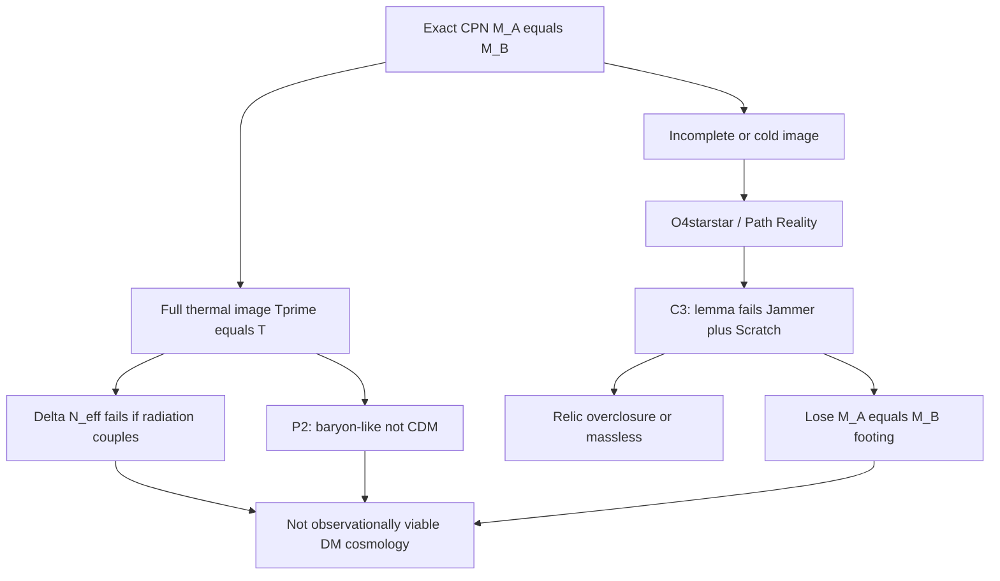

# Corpus viability audit — closed cosmology/DM theory — Cursor Main

**From:** Cursor Main · **To:** Greg, AC · **Cc:** Jammer, Scratch, PC · **Date:** 2026-10-06  
**Scope:** Multi-pass cross-check of Core deposit + 2026-10-06 Working/Handoffs against the question: *Can NTE generate a closed, observationally viable cosmology/DM theory under No-f and the deposit as written?*  
**Nothing patched. No f.**

**Passes:**  
1. Deposit ledger inventory (Part 1–3, C5)  
2. Kill-axis audit (ΔN_eff, P2, ColdConjugate C3, Path Reality, Axis B, L1, bilateral ν)  
3. Survivors / falsifiers independent of κ≡Planck-CDM  
4. This correlation

---

## 0. One-line verdict

**No** — not under the deposit as written and No-f. NTE remains a serious **framework candidate** with an intact geometric spine and live falsifiers; it is **not** presently a closed model that accounts for observed dark matter and early-universe radiation history without either breaking CPN (and losing κ’s footing) or adding sized new content (forbidden as 12(c) if tuned to data).

---

## 1. What “closed, observationally viable” requires

| Requirement | Needed for viability | Current status |
|---|---|---|
| R1 | Early radiation history compatible with BBN / N_eff | **Fails** under hot CPN + literal κ-coupling (ΔN_eff ≳ 3.7) |
| R2 | DM component that is cold, collisionless, and like-with-like vs Planck Ω_c/Ω_b **or** an honest replacement CDM story | **Fails** as Planck CDM (P2 Axis A); cold escape **C3-killed** |
| R3 | Internal consistency of the DM mechanism with its own premises (M_A=M_B, CPN image, annihilation/mass sources) | **Dilemma** — hot keeps CPN, cold breaks mass/relic |
| R4 | Cosmological origin / expansion history that exists | **Open** (option D; named obstructions) |
| R5 | Deposit ledger matches Working findings (no false “passed”) | **Register owed** — deposit still advertises withdrawn claims |

Closing R1–R3 under No-f is the existential block. R4 is independently open. R5 is documentation debt.

---

## 2. Kill axes (Pass 2) — correlated

| Axis | Landing | Survives without new axiom? |
|---|---|---|
| ΔN_eff (literal coupling) | N2/N5 — deposit BBN/N_eff lines cannot stand | No |
| P2 κ≡Planck CDM | Match **withdrawn**; number 5.50 survives | Match: No |
| Cold conjugate (O4\*\*) | **C3 HOT forced** (opposed briefs) | No |
| Axis B isocurvature-at-CMB | **B-underdetermined** (z∼0 erratum) | N/A — does not reopen Tier A alone |
| Bridge radiation filter (O1/N1a) | **Absent** from deposit | Would be new content |
| Reverse time / fit x≲0.3 | **Forbidden** | — |

**CPN dilemma (no deposited third option):**  
(1) Full CPN image → hot → R1 and R2 fail.  
(2) Not full image → R3 fails (κ loses M_A=M_B; relic ~10⁸ or radiation).  
Path Reality attempted (2); both independent legs killed it.

---

## 3. Deposit still advertises vs Working truth (Pass 1 ↔ 2)

| Deposit claim | Deposit grade | Working/Handoff truth |
|---|---|---|
| κ=5.50 vs Planck 5.38 — 0.83σ **passed** | Derived + empirical handle (i) | **Match withdrawn**; unlike / Axis A |
| Standard BBN, N_eff=3.044 **derived** | Derived | **Cannot stand** under twin radiation |
| Invisible electromagnetically **and weakly** | Mechanism prose | **Cannot stand** as written (register item 6) |
| Native n_s, r | Already withdrawn in deposit | Aligned |
| Origin sector / T_GB = hot BB | Open / cannot stand (Part 3 admits) | Aligned |
| κ “unaffected” by origin sector | Part 3 Open work | Algebra may survive; **empirical channel** already dead |

Until the register is applied, the **published deposit overclaims** relative to the corpus’s own critical lanes.

---

## 4. What still works (Pass 3) — spine without κ≡CDM

| Intact | Grade / role | Observational meaning |
|---|---|---|
| κ₀ = 3/√(4π) → κ = 5.50 **algebra** | Clean geometric | Bilateral ratio; **not** demonstrated = Planck Ω_c/Ω_b |
| Majorana / unresolved ν / exactly 3 modes | Forced / falsifiable | 0νββ; Dirac kills; 4th mode diverges |
| Normal ordering preference (eigenmode geometry) | Structural | Neutrino data |
| M₁ leptogenesis-scale consistency | Cross-check O(1) | Not zero-param η_B |
| Solar ν shape (8π branch) | Branch-contingent | Atm overshoot open |
| w = −1 / unimodular Λ reframing | Adopted / structural | Empirical handle (ii) |
| Closed S³ ⇒ Ω_k < 0 | Ontological | One-sided falsifier |
| σ(M) ∝ M^{−1/2} | Derived scaling | Late LSS; can live without κ≡Planck |
| CPN pairing ≠ BFT time-reversal | Architecture | Unique vs BFT |
| Surface-only Janus / common t | Architecture | Unique vs BFT |
| Door B / open origin honesty | Method | Correctly open |
| Part 1 §II axioms (H=β\|Φ\|², β input, one Φ) | Load-bearing | Not killed by DM crisis |

**Stale / damaged unique claims:** zero-parameter κ≡Planck CDM; BFT discriminator via conditional r (native n_s,r withdrawn).

---

## 5. Path Reality pieces — keep / kill / regrade

| Piece | Disposition |
|---|---|
| **O4\*\*** | **Do not ratify** (C3 both legs) |
| **A1 as forced/default rescue** | **Regrade** — at best Construction economy / A3 silence |
| **O4\*V as forced** | **Regrade** to consistent (shared e₁ reading available) |
| **O3 / R3a as forced** | **Regrade** to consistent reading (SU(2)_R force vs non-field tension) |
| **Axis B z∼0 erratum** | **Keep** — deposit-faithful; B-underdetermined |
| **Reject Λ_R:=M_R fiat** | **Keep** |
| **O6** (κ number; match open/withdrawn) | **Keep as honest backstop** — not a closed cosmology |

---

## 6. Viability matrix (correlated)

| Path to closed cosmology/DM | Blocked by | Under No-f? |
|---|---|---|
| Maximal CPN thermal twin | ΔN_eff + P2 | Inadmissible as *observation match* |
| Cold incomplete gauge (Path Reality) | C3: mass/relic/CPN | Dead |
| Radiation excluded from κ bridge (O1) | Not deposited | New content; must be Hopf-forced first |
| Fit x≲0.3 cooling | Explicit f-amendment | **Forbidden** |
| Reverse-time cooling | Common t spine | **Forbidden** |
| Unmake magnitude-not-location to force adiabatic CDM | Destroys σ(M) story; still needs cold | Not a rescue |
| New axiom: “conjugate is not a thermal CPN image” | Rewrites κ premise | Greg-level theory change |
| Withdraw κ-as-DM; keep algebra + other handles | Consistent | **Honest residual theory** — not closed DM cosmology |

---

## 7. What would have to change for viability (honest options only)

Ranked by honesty, not preference:

1. **Accept residual theory (O6+):** κ is a bilateral geometric ratio, **not** Planck CDM; drop or rewrite DM = conjugate footprint as the observed CDM story; keep Majorana, w=−1, σ(M) as optional LSS, open origin. **Viable as a leaner framework; fails the original DM selling point.**

2. **New structural axiom (Greg-level):** redefine what the conjugate sector *is* so that either (a) radiation does not enter our Friedmann/κ equations by Hopf necessity, or (b) conjugate content is not a thermal SM image **without** claiming M_A=M_B the same way. Must not be sized to N_eff. **High bar; changes the theory.**

3. **Deposit-forced cold that keeps mass sources** — both C3 legs say this is **unavailable** on current deposit. Only reopen if unread Core text (none found in scoped searches) forces T′≪T without breaking CPN. **Presently closed.**

4. **Illicit:** fit f, x, Λ_R; invent twin-cooling narrative to hit x≲0.3. **Out.**

---

## 8. Register package (Working draft only — Greg GO to patch Core)

Aligned with AC arbitration + ColdConjugate C3 + this audit:

| # | Locus | Action |
|---|---|---|
| 1 | Part 3 / Part 2 / C5: κ vs 5.38 “passed” | **Withdraw match**; retain κ=5.50 as bilateral ratio; interpretation **open** or **not CDM** |
| 2 | Part 3: N_eff=3.044 / standard BBN **derived** | **Downgrade / withdraw** pending structural radiation rule |
| 3 | Part 2 §XIV “standard BBN recovered” via 10⁻⁶ | Scope to annihilation only; **do not** claim twin-DOF safety |
| 4 | “Invisible … weakly” | Restate or withdraw under shared-ν / SU(2)_R |
| 5 | Empirical handles | **Two** until κ channel re-established: w=−1, Majorana |
| 6 | Cold-conjugate / O4\*\* | Register **C3**: not ratified; Path Reality not a deposit derivation |
| 7 | Axis B | Register erratum: z∼0; B-underdetermined; P2 on Axis A |

---

## 9. Bottom line for Greg

**As a closed, observationally viable cosmology/DM theory:** the corpus **does not currently close**. The sharpest advertised result (κ≡Planck CDM) and the early-universe radiation claims are in mutual conflict with the CPN thermal image the deposit’s own symmetry forces (C3).

**As a legitimate research framework:** yes — with an intact geometric algebra (κ₀), forced Majorana structure, honest Door B / open origin, and live falsifiers — **provided** the deposit stops advertising the withdrawn match and derived N_eff, and the DM story is restated at O6 honesty or rebuilt from a new axiom that faces the CPN dilemma explicitly.

**Next scientific move (not another Path Reality campaign):** AC formal C3 arbitration → Greg chooses among §7 options 1–2 (or states a third that is not No-f) → register application → only then any new lemma work.

— Cursor Main, 2026-10-06.
