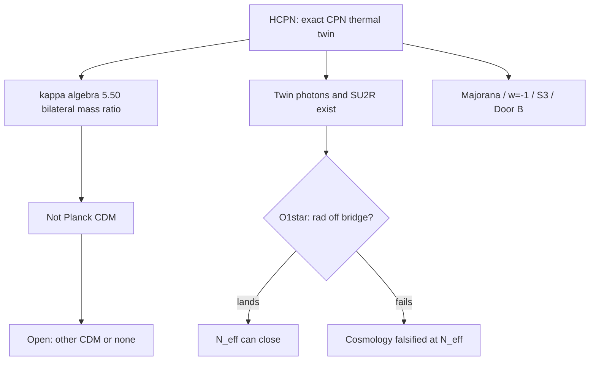

# Hot-CPN axiom re-evaluation — Cursor Main

**From:** Cursor Main · **To:** Greg, AC · **Cc:** Jammer, Scratch, PC · **Date:** 2026-10-06  
**Premise (assumed axiom, Greg):** Exact CPN that gives \(M_A=M_B\) (κ’s footing) **forces a thermal image** — \(T'=T\), full light gauge + fermionic content on −N as the CPN image of +N.  
**Prior audits:** `CORPUS_VIABILITY_AUDIT_…`, ColdConjugate C3 (Jammer+Scratch), P2 arbitration, ΔN_eff N5/N2.  
**Nothing patched. No f.** Cold-rescue campaigns (Path Reality / O4\*\*) are **out of scope** under this axiom.

---

## 0. Axiom lock

**HCPN (Hot CPN axiom).**  
The Janus pair is an exact CPN image at the level that underwrites κ: equal rest-mass content \(M_A=M_B\), shared nucleation, and therefore a **thermal twin** at equal temperature with conjugate gauge plasma (including EM confined to −N and SU(2)_R as the conjugate weak factor).

**Immediate corollary:** The ColdConjugate C3 landing is not merely a Working finding — it is **adopted as law**. Path Reality’s cold horn of the dilemma is **cut off by axiom**, not by preference.

---

## 1. Kill list (what fails under HCPN)

| ID | Claim | Why it dies under HCPN |
|---|---|---|
| **K1** | κ ≡ Planck \(\Omega_c/\Omega_b\) (0.83σ “passed”) | Twin at \(T'=T\) is **baryon–photon fluid**, not cold collisionless CDM (P2 Axis A). **Killed.** |
| **K2** | “Standard BBN / \(N_{\mathrm{eff}}=3.044\) derived” under literal κ-coupling | Twin radiation + matter at \(x=1\) ⇒ ΔN_eff ≫ bound if \(T^{\mathrm{rad}}_{\mathrm{conj}}\) participates (N2). **Killed as written.** |
| **K3** | Conjugate sector is cold / no light gauge plasma (O4\*\*, A1-as-rescue, Path Reality) | Contradicts HCPN. **Killed.** |
| **K4** | “Invisible … weakly” as absolute | Under HCPN + shared bilateral ν (F1-default), weak invisibility is at best “our probes don’t couple,” not “no conjugate weak.” Deposit sentence **cannot stand as written** (register item 6). **Killed / must restate.** |
| **K5** | Construction-default “no twin photons” as cosmology closer | HCPN requires twin EM (confined to −N). A1-as-rescue **killed.** |
| **K6** | Tier-A restore via cold ∧ B-reopen | Cold conjunct false by axiom. **Killed.** |
| **K7** | Selective CPN (keep \(M_A=M_B\), drop mass sources / annihilation) | Forbidden by HCPN’s “exact image” reading. **Killed.** |

**Not killed by HCPN alone (still open or intact):** κ₀→κ **algebra**; Majorana/3-mode; w=−1; closed S³; Door B / open origin; Part 1 §II; σ(M) *scaling* (meaning may change — §3).

---

## 2. Limits that are now moot

These constraints were load-bearing **because** the corpus was trying to keep κ-as-CDM and/or cold-rescue N_eff. Under HCPN they no longer bind the survivors:

| Former limit | Why it was there | Status under HCPN |
|---|---|---|
| **L1** Must not admit twin photons (A1) | Save ΔN_eff while keeping twin matter for κ | **Moot** — twin photons required |
| **L2** Must not treat SU(2)_R as light dynamical gauge | O4\*\* / Construction | **Moot** — conjugate weak exists |
| **L3** Must protect “magnitude not location” as adiabatic-CDM blocker *and* κ spine | Tier A fight | **Partially moot** — Tier A dead anyway; clause free for LSS-only twin-baryon reading |
| **L4** Must not pursue O1 (radiation off bridge) as “rescue of dual crises” | Looked like 12(c) dual-save of κ-CDM + N_eff | **Moot as dual-save** — κ-CDM already dead; O1 can be asked as a **single** Hopf question (early universe only) |
| **L5** O3 face-local weak as forced rescue | Stop MeV re-thermalization | **Moot as rescue**; F1 equal-T is HCPN-native |
| **L6** Relic-overclosure arguments against interaction-free cold | Kill O4\*\* | **Moot** — cold off table; annihilation *required* under HCPN |
| **L7** Completeness vs Construction as open fork for photons | Undetermined gate | **Closed toward Completeness** by HCPN |
| **L8** Axis-B reopen as path to restore 0.83σ | Needed cold CDM | **Moot for Tier A** |

---

## 3. Survivors re-examined (clues)

### 3.1 κ₀ → κ = 5.50 algebra — **survives, meaning changes**

**Was:** DM:baryon = Planck CDM ratio.  
**Under HCPN:** Bilateral **thermal-sector** mass ratio from Hopf–Y₀₀ fixed point — the ratio of conjugate rest-mass content to ours in the coupled Einstein system.

**Clue:** The algebra never required coldness. Coldness was an *interpretive* graft for Planck CDM.  
**New reading candidates:**
- **κ-R1:** Geometric Janus mass ratio only — **not** identified with \(\Omega_c/\Omega_b\). Observed CDM is **outside** this mechanism (open or other physics).
- **κ-R2:** Ratio of *total* conjugate gravitational source to ours after annihilation — still not CDM-shaped at \(z\sim1100\).

**Implication:** Empirical handles drop to **two** (w=−1, Majorana) until a new DM story lands. This is honesty, not optional.

### 3.2 Part 1 null-time / non-embedding — **elevated clue (O1\* lane)**

Deposit (Part 1 §I, §III): photons/gluons **carry no rest energy**, **do not embed**, accumulate zero proper time. The cross-thickness DM bridge is built on the **unresolved neutrino** and rest-mass sectors (Part 2 §IX; C5).

**Former status:** Elevating “bridge couples only to rest-mass / embedding” was N1a — **absent**; C11 unimodular does **not** give it; looked like rescue.

**Under HCPN + moot L4:** This is now the **only** structural escape for R1 (N_eff) that does **not** break HCPN. Provenance is Hopf/embedding-first, **not** “save κ-CDM” (already dead).

**Lemma O1\* (commissioned under HCPN):**  
Derive from Part 1 embedding + Hopf–Y₀₀ that the κ fixed-point source is **rest-mass / embedded stress**, so \(T^{\mathrm{rad}}_{\mathrm{conjugate}}\) does **not** enter the bilateral closure — **before** quoting ΔN_eff.  
- If O1\* **lands:** early-universe R1 can close with hot twin; κ still ≠ Planck CDM (K1 stands).  
- If O1\* **fails:** HCPN+NTE is **falsified** by N_eff under literal coupling — clean scientific death of the cosmological package, spine may remain.

**Discipline:** No dial; no sizing to ACT. Fail closed if Hopf does not force it. C5 “total perceived gravity” remains the opposing deposited sentence — O1\* must either reconcile or lose.

### 3.3 σ(M) ∝ M^{−1/2} — **survives as LSS, retargeted**

**Was:** Scatter in DM-to-baryon ratio from spatial decoupling of κ-CDM.  
**Under HCPN:** Conjugate is twin **baryonic** sector (plus twin radiation). σ(M) can be reread as scatter in **two-orientation baryon** (or total mass) ratios from chaotic structure formation + magnitude-not-location — a **Foot/Berezhiani-class** twin-baryon variance, not CDM halo variance.

**Clue:** The CLT scaling never needed CDM microphysics.  
**Limit moot:** No longer need σ(M) to double as proof that κ *is* Planck CDM.

### 3.4 Magnitude not location — **freed**

**Was:** Simultaneously (i) κ spine, (ii) isocurvature wall, (iii) σ(M) engine.  
**Under HCPN:** (ii) no longer needed to block a false Tier A. Keep as: probes don’t see conjugate coordinates; LSS cross-correlation → ∼10⁻³ by \(z\sim0\) (deposit-faithful). CMB twin-baryon acoustics are a **prediction/problem**, not something to redefine away.

### 3.5 Bilateral neutrino / F1 — **default under HCPN**

Equal-T thermal contact via shared ν is **native** to HCPN. O3 (face-local weak) is demoted from “forced rescue” to optional refinement that must not break HCPN’s thermal image. If O3 reappears, it cannot be used to cool the twin.

### 3.6 Majorana, w=−1, closed S³, Door B, M₁, solar shape — **untouched**

None of these required cold conjugate or κ≡CDM. They remain the **residual empirical spine**.

### 3.7 Open origin sector — **still open, newly central**

With DM-as-κ-CDM dead, the framework’s cosmological existence claim leans harder on origin/acceleration honesty. No change to option D; priority rises because fewer “passed” handles remain.

---

## 4. New possibility space under HCPN

| ID | Possibility | What it needs | Status |
|---|---|---|---|
| **P-O1\*** | Rest-mass-only κ bridge ⇒ twin radiation does not spoil N_eff | Hopf-first derivation vs C5 “total T” | **Primary live lemma** |
| **P-κ≠CDM** | Keep κ algebra; withdraw CDM identification permanently | Register only | **Default under HCPN** |
| **P-newDM** | Observed CDM from other NTE structure (e.g. heavy sterile / locked modes) — not the thermal twin | New content; must not fit Ω_c | **Open programme**, not deposit |
| **P-twinB** | Twin baryons are a real sector: acoustic/CMB bounds become **tests**, not bugs to erase | Accept P2 as phenomenology of the twin | Honest; likely needs O1\* or is constrained like MBDM (x=1 hard) |
| **P-falsify** | O1\* fails ⇒ cosmological NTE+HCPN dies at N_eff | Nothing | **Allowed outcome** |
| **P-lean** | Geometry + Majorana + w=−1 only; cosmology/DM withdrawn to open | Register | Stable residual |

**Rejected under HCPN:** cold incomplete gauge; fit x≲0.3; reverse time; Λ_R fiat; restoring 0.83σ via cold.

---

## 5. Revalued NTE (architecture under HCPN)

### What NTE **is** under HCPN
- A **CPN-symmetric Janus** cosmology with a Hopf-fixed bilateral mass ratio κ≈5.50.  
- A geometric **Majorana / three-mode** neutrino ontology.  
- An honest **open** early-acceleration sector (Door B).  
- Twin sector = **thermal image** (axiom).

### What NTE **is not** (under HCPN, until proven otherwise)
- A derivation of Planck cold dark matter.  
- A derivation of SM-only \(N_{\mathrm{eff}}\) **unless** O1\* lands.  
- A cold-mirror or Construction-silent twin.

### Viability under HCPN

| Target | Status |
|---|---|
| Closed DM theory (= observed CDM) | **No** — K1 permanent under HCPN unless P-newDM succeeds later |
| Closed early cosmology (BBN/N_eff) | **Conditional on O1\*** only |
| Consistent Janus + particle spine | **Yes** — Majorana, κ algebra, w=−1, open origin |
| Residual research framework | **Yes** — cleaner than the cold-rescue tangle |

---

## 6. Programme under HCPN (ordered)

1. **Register (Working draft → Greg GO):** withdraw κ–Planck match; withdraw derived N_eff as written; kill O4\*\*/Path Reality; restate “invisible weakly”; adopt HCPN in Working ontology.  
2. **Commission Lemma O1\*** — sole R1 escape; Hopf/embedding-first; pre-register land/fail; No-f.  
3. **Do not** commission cold, x-fit, or Tier-A restore.  
4. **Optional later:** P-newDM only with independent structural basis.  
5. **If O1\* fails:** declare cosmological package falsified under HCPN; keep lean spine (P-lean).

---

## 7. Bottom line

Assuming **exact CPN ⇒ thermal twin** as axiom:

- **Kills** κ-as-Planck-CDM, deposit BBN/N_eff as written, all cold-rescue paths, and Construction-as-cosmology-closer.  
- **Frees** twin photons / SU(2)_R / Completeness, and **reopens O1\*** as a single-issue Hopf lemma (limits L1–L4 moot).  
- **Revalues** NTE as a **Janus thermal-twin + geometric κ-ratio + Majorana spine** theory whose DM-selling-point is withdrawn and whose early-universe survival hinges on one lemma: **does the κ bridge couple to radiation?**

That is a narrower, honester theory than Path Reality — and a clearer kill switch.

— Cursor Main, 2026-10-06.
