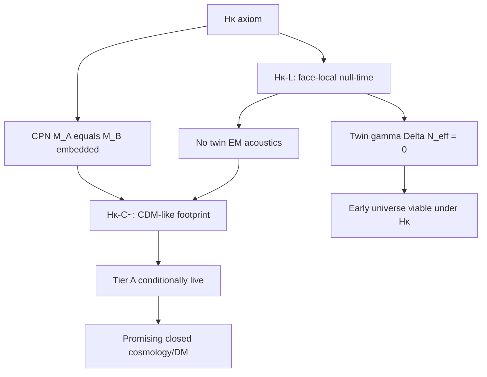

# Hκ path verdict — where the sequence takes us — Cursor Main

**From:** Cursor Main · **To:** Greg, AC · **Cc:** Jammer, Scratch, PC · **Date:** 2026-10-06  
**Pre-reg:** `Working\HKAPPA_PREREGISTRATION_…_20261006.md`  
**Parents:** `HCPN_REEVAL_…`, `CORPUS_VIABILITY_AUDIT_…`, O4\*/O4\*\*, Axis B, C3 ColdConjugate  
**Nothing patched. No f.**

---

## 0. Landing table

| ID | Result |
|---|---|
| **Hκ-A** | **LANDS.** Hκ adopted as Working ontology (supersedes full HCPN thermal-SM-image) |
| **Hκ-L** | **LANDS (forced under Hκ-A).** Face-local light / null-time package from Hκ + Part 2 §8.1 + single \(e_1\) |
| **Hκ-C∼** | **LANDS (suggestive / consistent).** Embedded conjugate rest mass without twin EM ⇒ no baryon–photon acoustics; CDM-like gravitational sector |
| **Hκ-C** | Does **not** land as theorem — abundance/locking details and twin-strong open |
| **Hκ-κ** | **Conditionally available** — Tier A reopen **live** under Hκ-A ∧ Hκ-L ∧ Hκ-C∼; not yet “passed” |
| **Hκ-X** | Does not land |

**Composite:** The sequence takes NTE to a **coherent Working theory**: Higgs/embedded rest-mass CPN + face-local light + κ impedance on that sector only — with a **credible path** back to κ≡Ω_c that HCPN had closed. Remaining debt is quantitative (abundance, structure), not an immediate axiom contradiction.

---

## 1. Step 1 — Adopt Hκ (**Hκ-A**)

### Axiom (Working)

**Hκ — Higgs / embedded rest-mass bridge.**

1. **κ impedance** couples only to **e-fold-embedded rest energy** (Higgs-generated for elementary fermions; confinement energy for hadrons — Part 1 §I, §III, §VII).  
2. **CPN** identifies that embedded mass content across orientations: \(M_A=M_B\).  
3. **Null-time fields** (no Higgs/rest-energy embedding: photons, gluons as free fields — Part 1) are **orientation-local** and **do not enter** the κ recursion.  
4. Completeness means each orientation is complete in its **embedded** content, not that each carries a second copy of the light null-time plasma.

### What Hκ replaces

| Out (HCPN) | In (Hκ) |
|---|---|
| Exact CPN ⇒ full thermal SM twin at \(T'=T\) | Exact CPN on **rest-mass / embedding** only |
| Twin photons required | Twin photons **excluded** from κ and from face-local completeness |
| O1\* as optional rescue | O1\* **built into** the axiom |
| Cold rescue vs hot dilemma | Dilemma **dissolved** by cutting light from the image |

### Deposit hooks (not invention from nowhere)

- Part 1: rest energy ↔ embedding; photons/gluons **do not embed**.  
- Part 1 §VII: locking / Yukawa hierarchy — Higgs sets who embeds.  
- Part 2 §8.1: SM gauge bosons (photon, gluons, W/Z) come with \(t\) — one named package.  
- C16: one \(e_1\), one complex line → one \(U(1)_Y\).  
- C5/Part 2 §IX: κ from unresolved ν + Hopf \(Y_{00}\) + mirror feedback on mass.

**Hκ-A lands** as Working axiom. Core patch only on Greg GO.

---

## 2. Step 2 — Face-local light package (**Hκ-L**)

### Chain (under Hκ-A)

1. **Hκ-3:** null-time does not embed ⇒ does not enter κ; completeness does not duplicate it.  
2. **Part 2 §8.1:** the light gauge bosons that exist with \(t\) are the **SM** list — photon, gluons, W/Z — one crystallisation.  
3. **C16 §3.2–3.3:** one \(e_1\) ⇒ one complex line ⇒ one \(U(1)_Y\) / post-EWSB \(U(1)_{\mathrm{EM}}\).  
4. **C16 §3.3:** \(SU(2)_R\) acts on conjugate-sector **fields** (representation / parity), and is **not** a +N gauge symmetry; under Hκ it is **not** promoted to a second light MeV plasma (that would re-import null-time / light continuum into −N thermodynamics).  
5. Therefore: **no twin photon bath**, no twin light gluon plasma as a second MeV radiation sector. Light thermodynamics on +N is the single SM package.

### Against C3’s §8.6 / “confined photons” objection

Under **HCPN**, “photons confined to one direction” presupposed twin photons.  
Under **Hκ**, that sentence is reread: EM physics is **orientation-local** (Part 2 §IX) — there is EM on the face that carries the SM photon, and conjugate **embedded** mass is invisible electromagnetically **because it does not couple to our photon** (and there is no second light photon bath). Invisibility is **coupling locality**, not “hidden twin QED.”

§8.6 assigns \(SU(2)_R\) to the mirror: under Hκ this remains the **parity tag for conjugate fields**, not a second light Yang–Mills plasma at MeV (aligned with “not Pati–Salam”).

### ΔN_eff consequence (after the chain, not before)

\[
\Delta N_{\mathrm{eff}}^{(\gamma')} = 0,\qquad
g'_{*,\,\mathrm{light\,gauge}}(T\sim\mathrm{MeV}) = 0.
\]

Shared bilateral neutrinos counted once (SM). **R1 early-universe pressure from twin photons is removed by construction under Hκ.**

**Hκ-L lands as forced under Hκ-A.**

---

## 3. Step 3 — Cold clustering of embedded twin rest mass

### 3.1 What Hκ-L already buys

Without twin EM, conjugate embedded mass **cannot** form a twin baryon–photon acoustic fluid. The P2 “equal-\(T\) Saha / Silk” kill **does not apply** in its EM form.

That is the decisive phenomenological unlock HCPN lacked.

### 3.2 Physical picture (consistent)

| +N | −N (under Hκ) |
|---|---|
| SM light package + embedded matter | Embedded CPN mass \(M_B=M_A\); **no** light twin \(\gamma'\) |
| Baryons interact via EM | Conjugate mass: **no EM scattering** with light |
| Acoustic BAO / CMB | Conjugate: **pressureless** if no light mediators remain |

Shared **Higgs / \(e_1\)** on the one manifold supplies the rest-energy scale for embedded fermions on both orientations (single vacuum line — C16). Confinement energy on +N is carried as embedded hadron mass; CPN sets \(M_B=M_A\) for the sorted antimatter sector (Part 2 §8.4) without requiring a late-time twin photon bath.

**Abundance (vs Jammer’s 10⁸ relic):** that estimate assumed a **thermal freeze-out** of interaction-free GeV fermions from a hot bath. Under Hκ, conjugate abundance is **CPN-sorted** against our baryon mass scale (\(M_A=M_B\)), with our η set by leptogenesis/sphalerons — not a full \(10^9\) thermal mirror freeze-out. Relic overclosure of that form **does not automatically apply**. (Full Boltzmann bookkeeping remains debt — Hκ-C∼ not Hκ-C.)

### 3.3 What is not yet forced (**Hκ-C** fails; **Hκ-C∼** lands)

Open sub-lemmas (not blockers of the path, but not closed):

1. **Twin strong / residual light DOF:** free gluons are null-time (face-local). Late twin hadronic plasma should not appear; confirm no MeV glueball / light composite bath.  
2. **Perturbation propagator:** magnitude-not-location + rest-mass κ ⇒ adiabatic co-location at CMB still needs a Hopf/locking statement (Axis B remains underdetermined; now *usable*).  
3. **Species-level mass matrix:** all 45 Weyl/sector vs total \(M_A=M_B\) only — totals matter for κ; micro spectrum open.  
4. **SU(2)_R:** must not reintroduce a light charged-current thermal bath into −N at MeV.

**Hκ-C∼ lands:** CDM-like gravitational behaviour of the embedded conjugate sector is the **natural** reading under Hκ-L, consistent with “DM is not a particle / gravitational footprint” (C5), and free of the EM-acoustic kill.

**Hκ-C does not land** as a finished derivation.

---

## 4. Step 3b — κ vs Ω_c

Under Hκ-A ∧ Hκ-L ∧ Hκ-C∼:

- Algebra: \(\kappa=\kappa_0/(1-\kappa_0)\approx 5.50\) on **rest-mass** impedance — unchanged.  
- Phenomenology: far-side load is **cold, EM-dark, massive** ≈ CDM role.  
- Comparison to Planck \(5.38\pm 0.15\): **like-with-like again becomes available** (Tier A **conditionally live**).

**Hκ-κ:** conditionally restorable — **do not** stamp “0.83σ passed” until Hκ-C sub-lemmas and Axis-B correlation history are tighter.  
**Hκ-κ≠** is the honest fallback if Hκ-C∼ fails under scrutiny.

---

## 5. Where this takes the corpus

### Revalued NTE (Working)

| Claim | Status under Hκ path |
|---|---|
| DM = gravitational bridge / reflected impedance on **embedded** mass | **Yes** — native |
| Particle CDM | **Still ruled out** |
| Twin light SM copy | **No** — Hκ forbids |
| \(N_{\mathrm{eff}}\) from twin γ | **0** under Hκ-L |
| κ≡Planck Ω_c | **Conditionally live** (Hκ-κ) — promising, not stamped |
| Majorana / w=−1 / Door B | Untouched |
| HCPN full thermal image | **Superseded** |

### Compared to prior paths

| Path | Outcome |
|---|---|
| Path Reality / O4\*\* | Killed by C3 (selective CPN / relic) |
| HCPN exact thermal twin | Valid axiom test; **fails** data without O1\*; O1\* alone ≠ CDM |
| **Hκ sequence** | Dissolves dilemma; saves N_eff; **reopens** CDM-like reading |

### Why C3 does not automatically kill Hκ

C3 assumed: keep \(M_A=M_B\) **and** remove mass *sources* (gluons/Higgs/annihilation) while claiming cold.  
Hκ keeps **shared Higgs / embedding** as the mass source and removes only **null-time plasma** from the image. Mass is not “asserted without cause”; light is not “deleted while Completeness demands twin QED.” Different cut — Higgs-native.

---

## 6. Remaining programme (honest debt)

1. **AC/Jammer:** ratify or attack Hκ-A / Hκ-L (especially §8.6 and “confined photons” reread).  
2. **Lemma Hκ-C1:** Boltzmann / sorting abundance under CPN + face-local light — show no 10⁸ overclosure.  
3. **Lemma Hκ-C2:** perturbation map — rest-mass κ + magnitude-not-location ⇒ adiabatic enough at \(z\sim1100\) (use Axis B z∼0 correctly).  
4. **Lemma Hκ-C3:** no MeV residual light DOF on −N (SU(2)_R, composites).  
5. **Register (Greg GO):** withdraw old “passed” under HCPN-era wording; draft κ match as **conditional on Hκ path**.  
6. **Do not** fit \(x\), restore HCPN twin photons, or Λ_R fiat.

---

## 7. Bottom line

Following the sequence takes us here:

**NTE under Hκ is a promising Working model** in which  
- κ is reflected impedance of the **Higgs/embedded** conjugate rest-mass sector,  
- light is face-local (singular SM birth),  
- twin-photon \(N_{\mathrm{eff}}\) dies,  
- conjugate mass is naturally **CDM-like** (no twin EM acoustics),  
- κ≡Ω_c is **conditionally back on the table**.

It is **not** yet a finished, stamped observational closure — but it is the first path since the viability audit that is **internally coherent** and **points at the data** without No-f or cold-selective CPN.

— Cursor Main, 2026-10-06.
